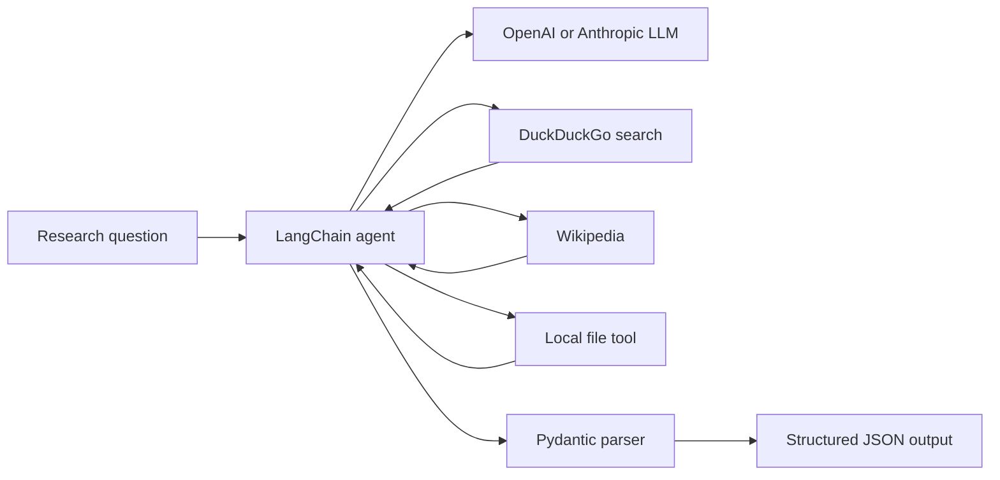

# AI Research Assistant

A command-line research agent that combines a large language model with web search, Wikipedia, structured output validation, and local file saving.


## Overview

The assistant accepts a research question in the terminal, selects either an Anthropic or OpenAI model from the configured environment, and gives the model access to three tools: DuckDuckGo search, Wikipedia lookup, and local note saving. Its final response is validated with Pydantic and printed as structured JSON.

This project demonstrates tool-using agents, provider selection, schema-constrained output, defensive error handling, and safe local file creation.

## Features

- Interactive command-line research workflow
- Anthropic and OpenAI model support
- Automatic provider selection from environment variables
- DuckDuckGo web search with titles, URLs, and snippets
- Wikipedia summaries with disambiguation handling
- Optional timestamped local note saving
- Pydantic-validated JSON responses
- Friendly handling for missing API keys and unavailable model IDs
- Filename sanitization for agent-created files

## Architecture



The main application builds the agent and validates its response. Tool implementations live separately in `tools.py`, which keeps external operations isolated from the CLI and output-parsing logic.

## Project Structure

```text
.
├── main.py                 # Provider selection, agent setup, CLI, and parsing
├── tools.py                # Search, Wikipedia, and file-saving tools
├── requirements.txt        # Python dependencies
├── langchain_research.txt  # Project notes
├── .gitignore
└── README.md
```

## Setup

### 1. Clone the repository

```bash
git clone https://github.com/SharathKumarReddyAlijarla/AI-Research-Assistant.git
cd AI-Research-Assistant
```

### 2. Create a virtual environment

Windows PowerShell:

```powershell
python -m venv .venv
.\.venv\Scripts\Activate.ps1
```

macOS or Linux:

```bash
python3 -m venv .venv
source .venv/bin/activate
```

### 3. Install dependencies

```bash
python -m pip install --upgrade pip
python -m pip install -r requirements.txt
```

### 4. Configure a model provider

Create `.env` in the repository root and add one provider key:

```dotenv
ANTHROPIC_API_KEY=replace_with_your_key
# OPENAI_API_KEY=replace_with_your_key
```

Optional model overrides:

```dotenv
ANTHROPIC_MODEL=replace_with_an_available_anthropic_model
OPENAI_MODEL=replace_with_an_available_openai_model
```

Only one API key is required. When both are configured, the current implementation gives Anthropic priority.

## Usage

Run the assistant:

```bash
python main.py
```

Example prompt:

```text
What can I help you research? What are the main applications of invertible neural networks?
```

Expected response shape:

```json
{
  "topic": "Invertible neural networks",
  "summary": "A concise research summary.",
  "sources": [
    "https://example.org/source"
  ],
  "tools_used": [
    "search_tool",
    "wiki_tool"
  ]
}
```

The agent can also call `save_tool` to write a timestamped text file in the current working directory.

## Results

The implemented workflow produces a validated four-field JSON object containing the topic, summary, source URLs, and tool names used. Tool errors are returned to the agent as readable text so one failed lookup does not necessarily terminate the whole research request.

This repository does not currently include a benchmark suite for factual accuracy, citation correctness, latency, or provider-to-provider comparison.

## Technology Stack

| Area | Technology |
| --- | --- |
| Language | Python |
| Agent framework | LangChain |
| Model providers | OpenAI and Anthropic |
| Schema validation | Pydantic |
| Web search | DuckDuckGo Search |
| Reference lookup | Wikipedia |
| Configuration | python-dotenv |

## Limitations

- Web search and Wikipedia require an internet connection.
- Model use requires a valid provider API key and may incur provider charges.
- Search results are summarized by the model; URLs and claims are not independently verified by the application.
- The workflow is single-turn and does not retain conversation memory.
- Provider model names and availability can change over time.
- Automated tests, streaming responses, retry policies, and citation validation are not yet included.
- The file tool writes plain text only and is intended for local development use.

## Security

- Never commit `.env` or real API keys.
- Rotate a provider key immediately if it is exposed.
- Review generated research and source URLs before using them in academic or professional work.
- Treat model-generated content as a draft, not as independently verified research.

## Roadmap

- [ ] Add source and citation verification
- [ ] Add streaming output
- [ ] Add conversation memory
- [ ] Add tests for tools and response parsing
- [ ] Add retries and request timeouts
